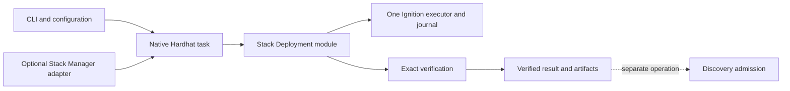

# Standalone Stack Deployment through Hardhat Ignition

Owner-approved architecture, updated 2026-11-13.
Inspected HEAD/main: 019d45beb5954e77fe806d643845f6a4dca4fa82.
The working tree is dirty on the owner-approved testnets_deploy branch.
The native task retains its implementation completion and historical local verification record: the focused profile passed; the repository gate failed on two unchanged URL fixtures. The owner deleted all prior deployment-task artifacts, including the final local run and public preflight/attempt records, on 2026-11-13. Fresh owning checks and the applicable verification profile are required before the next deployment or completion claim; deleted receipts do not certify the current candidate.

The abandoned public attempt's contracts remain untouched. Its local receipts and journal are deleted; do not resume or import it. Future evidence-retention requirements below remain in force.

## Ownership

The native Hardhat task is the operator's CLI/config adapter to one deep Stack
Deployment module. It owns preflight, Deployment Reconciliation, the existing
Ignition/Hanko graph, exact verification and terminal result writing under
Hardhat's supported Node/TypeScript environment. Bun may launch the command; an
external Bun financial orchestrator is not retained.

Stack Manager may call the same implementation through a thin adapter. Catalog
admission, publication authority, gossip and Runtime activation are separate
consumer responsibilities. The standalone operation does not need a catalog
key or read/write catalog configuration.



The interface is the test surface: real local scenarios enter the native task
and inspect transactions, chain state and evidence. Moving calls without moving
identity, verification and evidence ownership would leave the module shallow.
The intended depth gives locality to deployment fixes and leverage to both
operator and optional application callers.

## Invocation and configuration

The agreed task interface uses standard Hardhat network selection, JSON
deployment parameters, explicit deployment ID and new/resume intent. The
command below is available from `jurisdictions/`. Public execution requires a separate fresh preflight and is not part of the local implementation run:

```sh
bunx hardhat xln-deploy \
  --network ethereum-sepolia \
  --parameters ignition/parameters/ethereum-sepolia.json \
  --deployment-id eth-sepolia-01 \
  --mode new
```

Resume retains the ID and candidate with explicit resume intent. Network/RPC
values come from Hardhat configuration/environment; private keys and provider
credentials remain transient secrets. Parameters must remain reusable across
IDs even though native module/Future IDs are namespaced by deployment identity.

There is no two-network cap. The initial targets are Ethereum Sepolia
(11155111) and Arbitrum Sepolia (421614), using the owner's selected existing
six-decimal USDC. Every additional EVM network needs bytecode/gas/token/RPC
compatibility evidence. Native TRON is not established by two EVM targets.

## Execution and verification

Retain the existing eight creations, two bindings and first stablecoin listing.
The base graph and full listing graph share one deployment identity/journal.
Canonical Hanko uses actual deployed addresses and the original action nonce
one. Native Ignition alone decides completion, retry and fee replacement.

Prepare and bind exact compiler artifacts before sending; do not introduce a
new compiler, Solidity change or copied signing formula. After execution,
verify canonical receipts, exact linked runtime code/immutables, constructor
authority, both live bindings and selected USDC registration/metadata.

The agreed policy remains one confirmation between operations and at least
twelve for every winning receipt before success. The inclusion block counts as
one; this depth is not Ethereum finality or Arbitrum L1 settlement.

## Evidence and outcomes

Retain the full native deployment directory, journal, artifacts and build
information. Reuse or consolidate existing manifests, receipt exports and
invocation records. The terminal JSON reports chain/attempt identity,
contract/token addresses, transactions, verification results, actual native
expenses and artifact links. It never becomes a transaction scheduler.

Malformed commands/configuration fail on stderr with nonzero exit before a
valid attempt exists. Caught valid-operation failures produce a failed JSON and
nonzero exit where storage is available; storage failures remain explicit.
SIGKILL can prevent final writing, so a last running report is not transaction
failure or success. Recovery comes from native evidence; preserve each
invocation's outcome.

Completed reruns re-verify current chain state with zero sends. Atomic result
writing and reconstruction cannot repeat a mined listing. Standalone execution
leaves catalog content unchanged.

## Implementation boundaries

The callable executor has no import-time sender. Both the standalone task and
existing fixture/wrapped-token dispatch call the same public native Ignition
engine with an explicit directory. The `xln-chain-stack` task preserves existing
chain-tool variants without claiming that the single-USDC verifier accepts
wrapped-token variants. It is not the operator completion interface.

The optional Stack Manager adapter launches `xln-deploy`, reads its verified
outcome and separately handles catalog admission/publication. It no longer owns
artifact capture, signing, transaction recovery or final confirmation waiting.

The standalone module reuses the existing verification primitives and canonical
Hanko, including genuine CJS-to-TypeScript consumers. Minimal dispatch/import adaptations may preserve
existing callers; no new UI/HTTP/publication feature belongs to this extraction.

The [CLI recovery boundary](../../.scratch/ignition-stack-migration/spec.md#cli-recovery-boundary-owner-decision-2026-11-13)
also applies to tickets 04–07: no Rust daemon, application HTTP server or wallet
UI is required for their execution and acceptance. Further TS/Rust HTTP/UI
development belongs to a [separate deferred follow-up](../../.scratch/stack-manager-http-integration/issues/01-deferred-http-ui-integration.md).
Preserve the existing paired Rust/private-worker envelope adjustment. Its
[minimal verification](../../.scratch/ignition-stack-migration/issues/09-minimal-rust-http-adapter-verification.md)
is required before including those coupled changes in a commit, independently
of CLI recovery. Green deployment-profile evidence does not certify Rust HTTP.

The chain-matrix caller already uses the same executor but has wrapped-token
variants and pending discovery output. Do not redirect every variant blindly
through the current single-USDC verifier or claim new variant proof. A genuine
incompatible case must be reported, not hidden behind a fallback.

Both selected public network configurations and existing-USDC JSON parameters
are present. Ethereum uses `ETH_SEPOLIA_RPC`; Arbitrum uses `ARB_SEPOLIA_RPC`.
The signer comes from `DEPLOYER_PRIVATE_KEY` through the existing secret channel.
No resolved secret-bearing configuration is serialized.

By default, native evidence is in
`jurisdictions/ignition/deployments/<deployment-id>/`. `--deployment-dir` selects
an explicit absolute or cwd-relative directory. `result.json` and per-invocation
results report outcomes; `journal.jsonl`, native artifacts/build information,
sealed execution identity, listing and receipt exports remain together. Resume
requires the same ID, sources, artifacts, parameters and native journal; the RPC
transport may change. Completed reruns can reconstruct a missing manifest.

## Delivery and limits

The [specification](../../.scratch/ignition-stack-migration/spec.md) is current.
Ticket [08: standalone task](../../.scratch/ignition-stack-migration/issues/08-standalone-hardhat-stack-deployment.md) retains its historical local verification record. Next are process ownership,
transaction/evidence conflicts, reorg verification and the complete interruption matrix. Completed 02/03 and the prototype retain
their historical statuses and measurements; their deleted artifacts cannot certify the current candidate.

The [ADR](../adr/0001-use-hardhat-ignition-for-recoverable-stack-deployments.md)
records the accepted choices, and the [design map](../../.scratch/ignition-stack-migration/map.md)
records the seven owner answers. Public execution, application integration,
Cross-J financial flows, dependency upgrades and unrelated repository repair
remain separate work. No public transaction, UI work, commit or push is part of the local validation.

## Focused verification

From the repository root, `bun run check:deployment` uses one stand lock and
runs artifact/ABI/TypeChain parity, strict deployment TypeScript, value-import
and CJS correctness lint, owning Hardhat tests, six Foundry invariant suites
plus dispute-gas tests, and real local native-task/caller scenarios sequentially.
Generated static contract artifacts remain checked; Svelte/React application
checks, browser E2E and unrelated Runtime/performance gates are excluded.
CJS exports are inferred and linted with `checkJs=false`; this is not strict JS
checking. The existing exact ESLint debt authority remains 315 rows with its
unchanged SHA; the focused profile admits only its exact scoped subset.
Tickets 04–07 add their owning recovery cases when delivered; they are not
silently treated as passing. Under the owner-approved
[verification scope](../../AGENTS.md#verification-scope), green `check:deployment`
and owning checks are the gate for qualifying contract/deployment-only work.
Broader changes and whole-XLN/mainnet release require the full repository and
owning gates. Known unrelated global failures remain visible release constraints.

## Expense accounting

`expenses.attemptTransactionFeesWei` sums unique canonical mined receipts for
all broadcasts known to the native journal, including reverts. Unmined hashes
remain explicit, and unavailable expense evidence is reported as unavailable.
The total is not a claim about all external activity or the signer's entire
balance delta. Ordinary transaction cost is `gasUsed * effectiveGasPrice`;
own type-3 blob fees are additive when both blob fields are available, following
the [Ethereum receipt schema](https://ethereum.github.io/execution-apis/api/methods/eth_getTransactionReceipt/).
Arbitrum's L1 poster component is already included in the L2 gas charge and is
not added twice ([official fee model](https://docs.arbitrum.io/arbitrum-essentials/how-to-estimate-gas)).
These network semantics do not replace public-network receipt/balance evidence.
