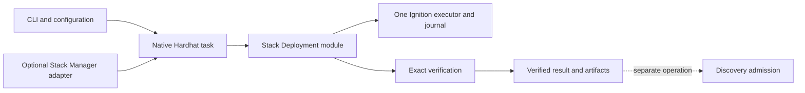

# Standalone Stack Deployment through Hardhat Ignition

Owner-approved architecture, updated 2026-11-13.
Inspected HEAD: 696f6f0ac67003dfffbd5625376f2e3f60256274.
The working tree is dirty on the owner-approved testnets_deploy branch.
Local evidence below identifies its exact dirty deployment candidate. Older
results and deleted artifacts cannot certify another candidate. Whole-product
acceptance and public-chain execution remain separate gates.

The abandoned public attempt's contracts remain untouched. Its local receipts and journal are deleted; do not resume or import it. Future evidence-retention requirements below remain in force.

## Ownership

The native Hardhat task is the operator's CLI/config adapter to one deep Stack
Deployment module. It owns preflight, Deployment Reconciliation, the existing
Ignition/Hanko graph, exact verification and terminal result writing under
Hardhat's supported Node/TypeScript environment. Bun may launch the command; an
external Bun financial orchestrator is not retained.

Stack Manager may call the same implementation through a thin adapter. Catalog
admission, publication authority, gossip and Runtime activation are separate
consumer responsibilities. The standalone operation does not need a catalog
key or read/write catalog configuration.



The interface is the test surface: real local scenarios enter the native task
and inspect transactions, chain state and evidence. Moving calls without moving
identity, verification and evidence ownership would leave the module shallow.
The intended depth gives locality to deployment fixes and leverage to both
operator and optional application callers.

## Invocation and configuration

The agreed task interface uses standard Hardhat network selection, JSON
deployment parameters, explicit deployment ID and new/resume intent. The
command below is available from `jurisdictions/`. Public execution requires a separate fresh preflight and is not part of the local implementation run:

```sh
bunx hardhat xln-deploy \
  --network ethereum-sepolia \
  --parameters ignition/parameters/ethereum-sepolia.json \
  --deployment-id eth-sepolia-01 \
  --mode new
```

Resume retains the ID and candidate with explicit resume intent. Network/RPC
values come from Hardhat configuration/environment; private keys and provider
credentials remain transient secrets. Parameters must remain reusable across
IDs even though native module/Future IDs are namespaced by deployment identity.

There is no two-network cap. The initial targets are Ethereum Sepolia
(11155111) and Arbitrum Sepolia (421614), using the owner's selected existing
six-decimal USDC. Every additional EVM network needs bytecode/gas/token/RPC
compatibility evidence. Native TRON is not established by two EVM targets.

## Execution and verification

Retain the existing eight creations, two bindings and first stablecoin listing.
The base graph and full listing graph share one deployment identity/journal.
Canonical Hanko uses actual deployed addresses and the original action nonce
one. Native Ignition alone decides completion, retry and fee replacement.

Prepare and bind exact compiler artifacts before sending; do not introduce a
new compiler, Solidity change or copied signing formula. After execution,
verify canonical receipts, exact linked runtime code/immutables, constructor
authority, both live bindings and selected USDC registration/metadata.

The agreed policy remains one confirmation between operations and at least
twelve for every winning receipt before success. The inclusion block counts as
one; this depth is not Ethereum finality or Arbitrum L1 settlement.

Before each dependent signature and on resume, current raw RPC receipts must
match the original inclusion block/hash recorded by native Ignition. A removed
or re-included winning transaction stops with
`STACK_MANAGER_IGNITION_RECEIPT_CONFLICT`. The journal remains intact; the task
does not silently rebase that evidence, wipe state or allocate another attempt.

Final verification selects a block number/hash after the confirmation wait.
The same verifier checks all eight linked runtimes, constructors, both bindings,
Foundation authority and token state at that block. Expense balance observation
uses the same block. The task rechecks the raw canonical block hash after those
reads and before atomic result writing; replacement invalidates the observation
with `STACK_MANAGER_CANONICAL_SNAPSHOT_CONFLICT`. Success records
`verification.point`, an observed canonical point rather than permanent finality.
A later reorganization requires current-chain verification again on resume.

## Evidence and outcomes

Retain the full native deployment directory, journal, artifacts and build
information. Reuse or consolidate existing manifests, receipt exports and
invocation records. The terminal JSON reports chain/attempt identity,
contract/token addresses, transactions, verification results, actual native
expenses and artifact links. It never becomes a transaction scheduler.

Malformed commands/configuration fail on stderr with nonzero exit before a
valid attempt exists. Caught valid-operation failures produce a failed JSON and
nonzero exit where storage is available; storage failures remain explicit.
SIGKILL can prevent final writing, so a last running report is not transaction
failure or success. Recovery comes from native evidence; preserve each
invocation's outcome.

Completed reruns re-verify current chain state with zero sends. Atomic result
writing and reconstruction cannot repeat a mined listing. Standalone execution
leaves catalog content unchanged.

## Implementation boundaries

The callable executor has no import-time sender. Both the standalone task and
existing fixture/wrapped-token dispatch call the same public native Ignition
engine with an explicit directory. The `xln-chain-stack` task preserves existing
chain-tool variants without claiming that the single-USDC verifier accepts
wrapped-token variants. It is not the operator completion interface.

The optional Stack Manager adapter launches `xln-deploy`, reads its verified
outcome and separately handles catalog admission/publication. It no longer owns
artifact capture, signing, transaction recovery or final confirmation waiting.

The standalone module reuses the existing verification primitives and canonical
Hanko, including genuine CJS-to-TypeScript consumers. Minimal dispatch/import adaptations may preserve
existing callers; no new UI/HTTP/publication feature belongs to this extraction.

The [CLI recovery boundary](../../.scratch/ignition-stack-migration/spec.md#cli-recovery-boundary-owner-decision-2026-11-13)
also applies to tickets 04–07: no Rust daemon, application HTTP server or wallet
UI is required for their execution and acceptance. Further TS/Rust HTTP/UI
development belongs to a [separate deferred follow-up](../../.scratch/stack-manager-http-integration/issues/01-deferred-http-ui-integration.md).
Preserve the existing paired Rust/private-worker envelope adjustment. Its
[minimal verification](../../.scratch/ignition-stack-migration/issues/09-minimal-rust-http-adapter-verification.md)
is required before including those coupled changes in a commit, independently
of CLI recovery. Green deployment-profile evidence does not certify Rust HTTP.

The chain-matrix caller already uses the same executor but has wrapped-token
variants and pending discovery output. Do not redirect every variant blindly
through the current single-USDC verifier or claim new variant proof. A genuine
incompatible case must be reported, not hidden behind a fallback.

Both selected public network configurations and existing-USDC JSON parameters
are present. Ethereum uses `ETH_SEPOLIA_RPC`; Arbitrum uses `ARB_SEPOLIA_RPC`.
The signer comes from `DEPLOYER_PRIVATE_KEY` through the existing secret channel.
No resolved secret-bearing configuration is serialized.

By default, native evidence is in
`jurisdictions/ignition/deployments/<deployment-id>/`. `--deployment-dir` selects
an explicit absolute or cwd-relative directory. `result.json` and per-invocation
results report outcomes; `journal.jsonl`, native artifacts/build information,
sealed execution identity, listing and receipt exports remain together. Resume
requires the same ID, sources, artifacts, parameters and native journal; the RPC
transport may change. Completed reruns can reconstruct a missing manifest.

Local ownership fences the active deployment ID independently of the signer/chain
nonce lane, so changing parameters, signer or output directory cannot bypass an
active attempt. Both native tasks use these locks under
`jurisdictions/.xln-deployment-locks/`. This coordinates local callers, not other
machines or external transactions from the same wallet.

The owner record includes host, PID, process start and process group. Losing the
launcher does not release the native task's locks. Before retiring a dead owner's
lock, the task checks for surviving Node/Bun/solc execution in that group;
unreadable process evidence or unsupported owner metadata rejects the invocation.
Concurrent stale observers cannot retire a newly acquired lock. After the owned
processes have terminated, resume retains the native journal and marks the
original invocation interrupted; it does not reset or create a substitute stack.

The execution seal also retains the pre-send block/hash, sender nonce and native
balance, plus the configured native execution/fee policy. Before a resumed send,
known native receipts must explain consumed sender and Foundation nonces.
Ignition's proposed nonce is checked again before the signing provider receives
it. Unexplained external consumption, a known revert or incompatible evidence
stops the attempt without allocating another CREATE sequence. An explicit RPC
transport or credential change remains possible after the same chain and sealed
financial identity are verified.

The manifest uses one winning receipt per intended Future. Its transaction audit
retains every native broadcast, including losing replacement hashes. The audit
reader consumes the installed Ignition journal format only to derive reports and
admission checks; native Ignition still owns graph reconciliation, retries,
fee bumps and sends. A dependency or journal-format update requires the owning
recovery checks again. It does not introduce a second durable transaction journal.

## Delivery and limits

The [specification](../../.scratch/ignition-stack-migration/spec.md) is current.
Ticket [08: standalone task](../../.scratch/ignition-stack-migration/issues/08-standalone-hardhat-stack-deployment.md) retains its historical local verification record.
Ticket [04: process ownership](../../.scratch/ignition-stack-migration/issues/04-process-and-lock-recovery.md)
has recorded local results for launcher loss,
competing/stale ownership, exact-group timeout cleanup and zero-send resume.
Ticket [05: RPC, nonce and evidence](../../.scratch/ignition-stack-migration/issues/05-rpc-nonce-and-evidence-conflicts.md)
has recorded local results for pending/dropped recovery,
both fee-replacement winner orders, sender/Foundation conflicts, a real revert and credential redaction.
Ticket [06: canonical-chain completion](../../.scratch/ignition-stack-migration/issues/06-reorg-and-confirmation-admission.md)
has recorded reorg/depth results for removed/moved receipts,
construction and completed-resume conflicts, a late reorg and the exact 11/12 boundary.
Ticket [07: full recovery matrix](../../.scratch/ignition-stack-migration/issues/07-complete-recovery-matrix-and-handoff.md)
has recorded results for 22 transaction cuts, 8 writing cuts, archive validation and startup cleanup, plus integrated 04–06 and fixture/wrapped callers.
Read-only public preflight has since passed; full public deployment is the next delivery step. Completed 02/03 and the prototype retain
their historical statuses and measurements; their deleted artifacts cannot certify the current candidate.

The [ADR](../adr/0001-use-hardhat-ignition-for-recoverable-stack-deployments.md)
records the accepted choices, and the [design map](../../.scratch/ignition-stack-migration/map.md)
records the seven owner answers. Public execution, application integration,
Cross-J financial flows, dependency upgrades and unrelated repository repair
remain separate work. No public transaction, UI work, commit or push is part of the local validation.

## Focused verification

From the repository root, `bun run check:deployment` uses one stand lock and
runs artifact/ABI/TypeChain parity, strict deployment TypeScript, value-import
and CJS correctness lint, owning Hardhat tests, six Foundry invariant suites
plus dispute-gas tests, and real local native-task/caller scenarios sequentially.
Generated static contract artifacts remain checked; Svelte/React application
checks, browser E2E and unrelated Runtime/performance gates are excluded.
CJS exports are inferred and linted with `checkJs=false`; this is not strict JS
checking. The existing exact ESLint debt authority remains 315 rows with its
unchanged SHA; the focused profile admits only its exact scoped subset.
Tickets 04–07 add their owning recovery cases when delivered; they are not
silently treated as passing. Under the owner-approved
[verification scope](../../AGENTS.md#verification-scope), green `check:deployment`
and owning checks are the gate for qualifying contract/deployment-only work.
Broader changes and whole-XLN/mainnet release require the full repository and
owning gates. Known unrelated global failures remain visible release constraints.

## Expense accounting

`expenses.attemptTransactionFeesWei` sums unique canonical mined receipts for
all broadcasts known to the native journal, including reverts. Unmined hashes
remain explicit, and unavailable expense evidence is reported as unavailable.
The total is not a claim about all external activity or the signer's entire
balance delta. Ordinary transaction cost is `gasUsed * effectiveGasPrice`;
own type-3 blob fees are additive when both blob fields are available, following
the [Ethereum receipt schema](https://ethereum.github.io/execution-apis/api/methods/eth_getTransactionReceipt/).
Arbitrum's L1 poster component is already included in the L2 gas charge and is
not added twice ([official fee model](https://docs.arbitrum.io/arbitrum-essentials/how-to-estimate-gas)).
These network semantics do not replace public-network receipt/balance evidence.

`expenses.balance` records initial/current blocks and hashes, raw native balances,
their delta and `unaccountedDeltaWei` after known journal receipt fees. An
unexplained delta remains explicit; it is not assigned to an invented fee or
transfer. Failed mined receipts retain their actual costs. Caught execution or
verification failures write an atomic failed result with the failing phase;
input/identity admission errors return stderr/nonzero without replacing the
retained historical outcome with a fabricated success.
Operators must check the command's exit status and current invocation. A failed
identity/origin admission can leave an older successful `result.json` intact;
that historical file does not certify the failed invocation.

## Next public preflight

The checked-in configurations select these independent attempts. IDs below are
proposals for later fresh deployments; first confirm their directories are absent.
They must not reuse or import the abandoned attempt.

| Hardhat network    | Configured chain ID | RPC environment   | Parameters                                                | Proposed ID               |
| ------------------ | ------------------: | ----------------- | --------------------------------------------------------- | ------------------------- |
| `ethereum-sepolia` |            11155111 | `ETH_SEPOLIA_RPC` | `jurisdictions/ignition/parameters/ethereum-sepolia.json` | `eth-sepolia-ignition-01` |
| `arbitrum-sepolia` |              421614 | `ARB_SEPOLIA_RPC` | `jurisdictions/ignition/parameters/arbitrum-sepolia.json` | `arb-sepolia-ignition-01` |

The configured addresses are Circle's listed testnet USDC addresses:
Ethereum `0x1c7D4B196Cb0C7B01d743Fbc6116a902379C7238` and Arbitrum
`0x75faf114eafb1BDbe2F0316DF893fd58CE46AA4d`.
[Circle's address list](https://developers.circle.com/stablecoins/usdc-contract-addresses)
and [Arbitrum's RPC/chain table](https://docs.arbitrum.io/arbitrum-essentials/reference/node-providers)
were accessed 2026-11-13. These documentation observations do not certify live
proxy implementations, balances or current public-chain compatibility.

Prerequisites: keep the tested source/artifacts unchanged; supply both actual
RPC URLs and the intended existing signer key through the private environment
or the existing private `~/.config/xln/testnet-deployer.env`; hold the stand lock. Do not print those values.
From the repository root, the read-only refresh command is:

```sh
bun run stand:run --reason public-deployment-preflight --timeout-ms 60000 -- \
  bun --env-file="$HOME/.config/xln/testnet-deployer.env" --eval '
import { JsonRpcProvider, Contract, Wallet, keccak256 } from "ethers";
import { readFile } from "node:fs/promises";
import { sanitizeDeploymentMessage } from "./jurisdictions/scripts/deployment/evidence.cjs";
import { safeStringify } from "./core/protocol/serialization/index.ts";
const secret = process.env.DEPLOYER_PRIVATE_KEY || "";
let rpc = "";
try {
  const signer = new Wallet(secret.startsWith("0x") ? secret : "0x" + secret).address;
  for (const [network, rpcName] of [["ethereum-sepolia", "ETH_SEPOLIA_RPC"], ["arbitrum-sepolia", "ARB_SEPOLIA_RPC"]]) {
    rpc = process.env[rpcName] || "";
    if (!rpc) throw new Error("PREFLIGHT_RPC_REQUIRED:" + rpcName);
    const parameters = JSON.parse(await readFile("jurisdictions/ignition/parameters/" + network + ".json", "utf8"));
    const provider = new JsonRpcProvider(rpc, parameters.chainId, { cacheTimeout: -1, pollingInterval: 100 });
    try {
      if (BigInt(await provider.send("eth_chainId", [])) !== BigInt(parameters.chainId)) throw new Error("PREFLIGHT_CHAIN_ID_CONFLICT");
      const block = await provider.send("eth_getBlockByNumber", ["latest", false]);
      const token = new Contract(parameters.stablecoin.address, ["function symbol() view returns (string)", "function decimals() view returns (uint8)"], provider);
      const [code, symbol, decimals, balance, nonce, pendingNonce, fees] = await Promise.all([
        provider.getCode(parameters.stablecoin.address, block.number), token.symbol({ blockTag: block.number }), token.decimals({ blockTag: block.number }),
        provider.getBalance(signer, block.number), provider.getTransactionCount(signer, block.number), provider.getTransactionCount(signer, "pending"), provider.getFeeData()
      ]);
      if (code === "0x" || symbol !== "USDC" || decimals !== 6n) throw new Error("PREFLIGHT_TOKEN_CONFLICT");
      if ((await provider.send("eth_getBlockByNumber", [block.number, false])).hash !== block.hash) throw new Error("PREFLIGHT_CANONICAL_POINT_CONFLICT");
      console.log(safeStringify({ network, chainId: parameters.chainId, signer, point: { number: block.number, hash: block.hash }, token: parameters.stablecoin.address,
        proxyCodeHash: keccak256(code), symbol, decimals: Number(decimals), balanceWei: balance.toString(), nonce, pendingNonce, blockGasLimit: block.gasLimit,
        feeQuote: { gasPriceWei: fees.gasPrice?.toString() ?? null, maxFeePerGasWei: fees.maxFeePerGas?.toString() ?? null, maxPriorityFeePerGasWei: fees.maxPriorityFeePerGas?.toString() ?? null } }));
    } finally { provider.destroy(); }
  }
} catch (error) {
  console.error(sanitizeDeploymentMessage(error instanceof Error ? error.message : String(error), secret, rpc));
  process.exitCode = 1;
}
'
```

This command only reads chain/token/signer observations, including a real batch
of RPC reads through the same ethers provider defaults as final verification.
It neither signs nor sends transactions, allocates a deployment ID, creates a
journal or publishes discovery. It passed against both public chains on
2026-11-13 UTC after the owner supplied both RPC variables. A refresh must still
require both network records and exit zero; partial output is not success.

Read-only public preflight passed on both networks: chain/token/signer reads,
proxy getters/code hashes, batched reads, reference-header matches, artifact
sizes and sixteen independent unsigned constructor estimates. Generated reports
are local run outputs and excluded from these commits. These observations do
not establish a third-party implementation build, a stateful eleven-operation
simulation, a full deployment cost cap or long-term archive guarantees.

The first remaining production boundary is complete native execution with the
two bindings and Hanko-authorized USDC listing, followed by winning receipts,
exact linked-code verification and expense reconciliation. The [current handoff](../night-work-plan.md) contains
the next Ethereum command, checked with `--help` only. The later deployment step
must refresh source/state/nonce/fee prerequisites and preserve its own evidence.

## Current local verification

The recorded final profile passed all six gates: 274 Hardhat tests, 64 Foundry
checks in seven suites and 93 Bun tests / 3,505 assertions. At verification time,
552 covered source and 181 compiler/ABI/TypeChain hashes matched the checked
candidate. The owner excluded generated local evidence files from these commits
on 2026-11-14. This document retains recorded outcomes; tests and verification
commands remain in the repository. The discarded detailed case records cannot
be reconstructed from this summary.
The recorded check ran on dirty HEAD `696f6f0ac67003dfffbd5625376f2e3f60256274`.
The unchanged deployment source is committed at `ceb1d0522d20b171ca21803f152ecf3fd5875441`;
unrelated owner edits remain dirty. Read-only public preflight subsequently
passed; no public broadcast is claimed. Future active/public deployment evidence
requirements are unchanged.
A running latest summary cannot erase an already terminal per-invocation archive;
unknown archived status types fail loudly. Fee-bump probes mine real empty blocks
without exposing artificially reduced block gas limits to the estimator.
