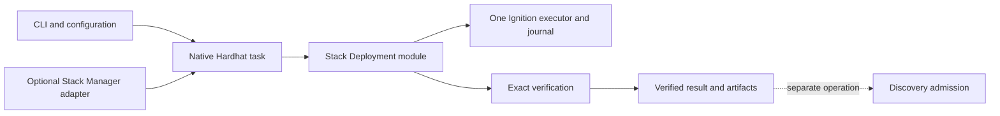

# Standalone Stack Deployment through Hardhat Ignition

Owner-approved architecture, updated 2026-11-14.
Public execution candidate: `49c26224497d5e875c369098f02d515e0fb81134`.
Read-only verifier source commit: `cb52df9da1b0e1f0291db08074df122680da4526`.
The subsequent read-only verifier fix is recorded separately from execution.
Both public deployments have recorded verification results below. Resolve the
current source SHA, dirty status and latest local checks from the
[execution handoff](../night-work-plan.md).
Older results and deleted artifacts cannot certify another candidate.
Whole-product acceptance and public financial flows remain separate gates.

The abandoned public attempt's contracts remain untouched. Its local receipts and journal are deleted; do not resume or import it. Future evidence-retention requirements below remain in force.

## Owner-approved execution exceptions

For this Sepolia deployment effort and the separately tracked
[reserve roundtrip](../../.scratch/sepolia-arbitrum-usdc-roundtrip/spec.md),
the owner's session decisions establish these task-scoped exceptions:

- Execute on the owner's MacBook Pro M5 and existing `testnets_deploy` branch. Preserve unrelated work and retain capacity-one stand locking.
- Owner decision, 2026-11-15: verification accepts `main` and `testnets_deploy`; pre-push accepts only the matching routes `main -> main` and `testnets_deploy -> testnets_deploy`. `HEAD` targets the checked-out branch's own remote branch. Preserve exact-SHA, stable-branch, clean-source and hidden-index checks. This route policy does not initiate a push or PR.
- The requirement for three different external AI reviewers is waived for this effort. This record authorizes no external-model dispatch.
- Exclude generated local test evidence from commits and remove it after verification, retaining runnable tests, commands and brief measured results. Deleted detailed cases cannot be reconstructed from summaries alone.
- Preserve active and future public deployment journals, sealed artifacts, receipts and original invocation outcomes. Their retention requirements are unchanged; exclusion from a source commit does not authorize deletion.

These exceptions leave financial authority, signing, verification and release
requirements in [AGENTS.md](../../AGENTS.md) in force. Deployment completion
does not start the separate financial probe or authorize a commit or push.

## Ownership

The native Hardhat task is the operator's CLI/config adapter to one deep Stack
Deployment module. It owns preflight, Deployment Reconciliation, the existing
Ignition/Hanko graph, exact verification and terminal result writing under
Hardhat's supported Node/TypeScript environment. Bun may launch the command; an
external Bun financial orchestrator is not retained.

Stack Manager may call the same implementation through a thin adapter. Catalog
admission, publication authority, gossip and Runtime activation are separate
consumer responsibilities. The standalone operation does not need a catalog
key or read/write catalog configuration.



The interface is the test surface: real local scenarios enter the native task
and inspect transactions, chain state and evidence. Moving calls without moving
identity, verification and evidence ownership would leave the module shallow.
The intended depth gives locality to deployment fixes and leverage to both
operator and optional application callers.

## Invocation and configuration

The agreed task interface uses standard Hardhat network selection, JSON
deployment parameters, explicit deployment ID and new/resume intent. The
command below is available from `jurisdictions/`. Public execution requires a separate fresh preflight and is not part of the local implementation run:

```sh
bunx hardhat xln-deploy \
  --network ethereum-sepolia \
  --parameters ignition/parameters/ethereum-sepolia.json \
  --deployment-id eth-sepolia-01 \
  --mode new
```

Resume retains the ID and candidate with explicit resume intent. Network/RPC
values come from Hardhat configuration/environment; private keys and provider
credentials remain transient secrets. Parameters must remain reusable across
IDs even though native module/Future IDs are namespaced by deployment identity.

There is no two-network cap. The initial targets are Ethereum Sepolia
(11155111) and Arbitrum Sepolia (421614), using the owner's selected existing
six-decimal USDC. Every additional EVM network needs bytecode/gas/token/RPC
compatibility evidence. Native TRON is not established by two EVM targets.

### Read-only verification of an existing deployment

Owner decision 2026-11-14: after a verifier-only correction, check an existing
sealed deployment without changing its execution identity or resuming sends.
Use the native `xln-verify` task. From the repository root:

```sh
DEPLOYER_PRIVATE_KEY='' bun run stand:run --reason existing-stack-verification --timeout-ms 180000 -- \
  node --env-file="$HOME/.config/xln/testnet-deployer.env" \
  node_modules/hardhat/dist/src/cli.js --config jurisdictions/hardhat.config.ts \
  xln-verify --network arbitrum-sepolia \
  --deployment-dir "$PWD/jurisdictions/ignition/deployments/arb-sepolia-ignition-01" \
  --output "$PWD/jurisdictions/ignition/deployments/arb-sepolia-ignition-01.readonly.json"
```

Inputs are the selected Hardhat HTTP network/RPC and the original manifest,
execution seal, native journal and artifact/build-info snapshot. The original
execution commit must be available in Git: every sealed source hash and its
inventory must match that commit. Missing, altered, foreign or unsupported
evidence fails closed; this command does not reconstruct deleted attempts.
It currently accepts the single-existing-token and local fixture variants;
wrapped-token variants are rejected explicitly.

The task uses the canonical stack verifier against the original sealed
artifacts. It does not compile, connect a signer or invoke the deployment
engine; its provider rejects RPC methods outside the explicit read allowlist.
No private key is required. `--output` is optional (stdout is always emitted);
a supplied path must be a new file outside the original deployment directory.
Existing paths and aliases into that directory are rejected.

Success exits zero and produces `status: verified`, the observation block/hash,
checks, original `executionCandidate`, current `verificationCandidate` with
source hashes, historical deployment expenses and zero signatures/broadcasts
for the current operation. It preserves every original invocation outcome,
including a failed `result.json`. Failure exits nonzero and emits no successful
report. A changed verifier is not permission to bypass `xln-deploy --mode resume`
source/policy identity checks or to certify a new execution candidate.

## Execution and verification

Retain the existing eight creations, two bindings and first stablecoin listing.
The base graph and full listing graph share one deployment identity/journal.
Canonical Hanko uses actual deployed addresses and the original action nonce
one. Native Ignition alone decides completion, retry and fee replacement.

Prepare and bind exact compiler artifacts before sending; do not introduce a
new compiler, Solidity change or copied signing formula. After execution,
verify canonical receipts, exact linked runtime code/immutables, constructor
authority, both live bindings and selected USDC registration/metadata.

The agreed policy remains one confirmation between operations and at least
twelve for every winning receipt before success. The inclusion block counts as
one; this depth is not Ethereum finality or Arbitrum L1 settlement.

For Arbitrum One (`42161`) and Arbitrum Sepolia (`421614`), Foundation's Solidity
`registrationBlock` uses the L1 context exposed by `block.number`; RPC receipt
`blockNumber` and confirmation depth use L2.
The verifier requires matching `l1BlockNumber` in the raw creation receipt and
its canonical L2 header before comparing Foundation registration. Missing or
inconsistent L1 context is an error, with no fallback to L2 height.
Other Nitro chain IDs require an explicit compatibility change and evidence.
See [Arbitrum block-number semantics](https://docs.arbitrum.io/arbitrum-essentials/arbitrum-vs-ethereum/block-numbers-and-time)
and [RPC extensions](https://docs.arbitrum.io/arbitrum-essentials/arbitrum-vs-ethereum/rpc-methods)
(accessed 2026-11-13 UTC).

Before each dependent signature and on resume, current raw RPC receipts must
match the original inclusion block/hash recorded by native Ignition. A removed
or re-included winning transaction stops with
`STACK_MANAGER_IGNITION_RECEIPT_CONFLICT`. The journal remains intact; the task
does not silently rebase that evidence, wipe state or allocate another attempt.

Final verification selects a block number/hash after the confirmation wait.
The same verifier checks all eight linked runtimes, constructors, both bindings,
Foundation authority and token state at that block. Expense balance observation
uses the same block. The task rechecks the raw canonical block hash after those
reads and before atomic result writing; replacement invalidates the observation
with `STACK_MANAGER_CANONICAL_SNAPSHOT_CONFLICT`. Success records
`verification.point`, an observed canonical point rather than permanent finality.
A later reorganization requires current-chain verification again on resume.

## Evidence and outcomes

Retain the full native deployment directory, journal, artifacts and build
information. Reuse or consolidate existing manifests, receipt exports and
invocation records. The terminal JSON reports chain/attempt identity,
contract/token addresses, transactions, verification results, actual native
expenses and artifact links. It never becomes a transaction scheduler.

Malformed commands/configuration fail on stderr with nonzero exit before a
valid attempt exists. Caught valid-operation failures produce a failed JSON and
nonzero exit where storage is available; storage failures remain explicit.
SIGKILL can prevent final writing, so a last running report is not transaction
failure or success. Recovery comes from native evidence; preserve each
invocation's outcome.

Completed reruns re-verify current chain state with zero sends. Atomic result
writing and reconstruction cannot repeat a mined listing. Standalone execution
leaves catalog content unchanged.

## Implementation boundaries

The callable executor has no import-time sender. Both the standalone task and
existing fixture/wrapped-token dispatch call the same public native Ignition
engine with an explicit directory. The `xln-chain-stack` task preserves existing
chain-tool variants without claiming that the single-USDC verifier accepts
wrapped-token variants. It is not the operator completion interface.

The optional Stack Manager adapter launches `xln-deploy`, reads its verified
outcome and separately handles catalog admission/publication. It no longer owns
artifact capture, signing, transaction recovery or final confirmation waiting.

The standalone module reuses the existing verification primitives and canonical
Hanko, including genuine CJS-to-TypeScript consumers. Minimal dispatch/import adaptations may preserve
existing callers; no new UI/HTTP/publication feature belongs to this extraction.

The [CLI recovery boundary](../../.scratch/ignition-stack-migration/spec.md#cli-recovery-boundary-owner-decision-2026-11-13)
also applies to tickets 04–07: no Rust daemon, application HTTP server or wallet
UI is required for their execution and acceptance. Further TS/Rust HTTP/UI
development belongs to a [separate deferred follow-up](../../.scratch/stack-manager-http-integration/issues/01-deferred-http-ui-integration.md).
The existing paired Rust/private-worker envelope adjustment has its own
completed [minimal verification](../../.scratch/ignition-stack-migration/issues/09-minimal-rust-http-adapter-verification.md).
That narrow result does not deliver further application integration, and green
deployment-profile evidence does not certify Rust HTTP.

The chain-matrix caller already uses the same executor but has wrapped-token
variants and pending discovery output. Do not redirect every variant blindly
through the current single-USDC verifier or claim new variant proof. A genuine
incompatible case must be reported, not hidden behind a fallback.

Both selected public network configurations and existing-USDC JSON parameters
are present. Ethereum uses `ETH_SEPOLIA_RPC`; Arbitrum uses `ARB_SEPOLIA_RPC`.
The signer comes from `DEPLOYER_PRIVATE_KEY` through the existing secret channel.
No resolved secret-bearing configuration is serialized.

By default, native evidence is in
`jurisdictions/ignition/deployments/<deployment-id>/`. `--deployment-dir` selects
an explicit absolute or cwd-relative directory. `result.json` and per-invocation
results report outcomes; `journal.jsonl`, native artifacts/build information,
sealed execution identity, listing and receipt exports remain together. Resume
requires the same ID, sources, artifacts, parameters and native journal; the RPC
transport may change. Completed reruns can reconstruct a missing manifest.

Local ownership fences the active deployment ID independently of the signer/chain
nonce lane, so changing parameters, signer or output directory cannot bypass an
active attempt. Both native tasks use these locks under
`jurisdictions/.xln-deployment-locks/`. This coordinates local callers, not other
machines or external transactions from the same wallet.

The owner record includes host, PID, process start and process group. Losing the
launcher does not release the native task's locks. Before retiring a dead owner's
lock, the task checks for surviving Node/Bun/solc execution in that group;
unreadable process evidence or unsupported owner metadata rejects the invocation.
Concurrent stale observers cannot retire a newly acquired lock. After the owned
processes have terminated, resume retains the native journal and marks the
original invocation interrupted; it does not reset or create a substitute stack.

The execution seal also retains the pre-send block/hash, sender nonce and native
balance, plus the configured native execution/fee policy. Before a resumed send,
known native receipts must explain consumed sender and Foundation nonces.
Ignition's proposed nonce is checked again before the signing provider receives
it. Unexplained external consumption, a known revert or incompatible evidence
stops the attempt without allocating another CREATE sequence. An explicit RPC
transport or credential change remains possible after the same chain and sealed
financial identity are verified.

The manifest uses one winning receipt per intended Future. Its transaction audit
retains every native broadcast, including losing replacement hashes. The audit
reader consumes the installed Ignition journal format only to derive reports and
admission checks; native Ignition still owns graph reconciliation, retries,
fee bumps and sends. A dependency or journal-format update requires the owning
recovery checks again. It does not introduce a second durable transaction journal.

## Delivery and limits

The [specification](../../.scratch/ignition-stack-migration/spec.md) is current.
Ticket [08: standalone task](../../.scratch/ignition-stack-migration/issues/08-standalone-hardhat-stack-deployment.md) retains its historical local verification record.
Ticket [04: process ownership](../../.scratch/ignition-stack-migration/issues/04-process-and-lock-recovery.md)
has recorded local results for launcher loss,
competing/stale ownership, exact-group timeout cleanup and zero-send resume.
Ticket [05: RPC, nonce and evidence](../../.scratch/ignition-stack-migration/issues/05-rpc-nonce-and-evidence-conflicts.md)
has recorded local results for pending/dropped recovery,
both fee-replacement winner orders, sender/Foundation conflicts, a real revert and credential redaction.
Ticket [06: canonical-chain completion](../../.scratch/ignition-stack-migration/issues/06-reorg-and-confirmation-admission.md)
has recorded reorg/depth results for removed/moved receipts,
construction and completed-resume conflicts, a late reorg and the exact 11/12 boundary.
Ticket [07: full recovery matrix](../../.scratch/ignition-stack-migration/issues/07-complete-recovery-matrix-and-handoff.md)
has recorded results for 22 transaction cuts, 8 writing cuts, archive validation and startup cleanup, plus integrated 04–06 and fixture/wrapped callers.
Recovery tickets 04–07 are complete. Both selected public deployments have
[recorded verification results](#verified-public-deployments-2026-11-14).
The separate [reserve roundtrip](../../.scratch/sepolia-arbitrum-usdc-roundtrip/spec.md)
has completed both public runs; its [operator guide](usdc-reserve-roundtrip.md)
records receipts, exact balances and native costs. Earlier deleted local
artifacts cannot certify another candidate.

The [ADR](../adr/0001-use-hardhat-ignition-for-recoverable-stack-deployments.md)
records the accepted choices, and the [design map](../../.scratch/ignition-stack-migration/map.md)
records the seven owner answers. Application integration, Cross-J financial
flows, dependency upgrades and unrelated repository repair remain separate work.

## Focused verification

From the repository root, `bun run check:deployment` uses one stand lock and
runs artifact/ABI/TypeChain parity, strict deployment TypeScript, value-import
and CJS correctness lint, owning Hardhat tests, six Foundry invariant suites
plus dispute-gas tests, and real local native-task/caller scenarios sequentially.
Generated static contract artifacts remain checked; Svelte/React application
checks, browser E2E and unrelated Runtime/performance gates are excluded.
CJS exports are inferred and linted with `checkJs=false`; this is not strict JS
checking. The existing exact ESLint debt authority remains 315 rows with its
unchanged SHA; the focused profile admits only its exact scoped subset.
The native recovery cases from tickets 04–07 are included. Native test discovery
is recursive and preserves the previous basename order;
support files are excluded and an empty test set rejects. The relocated suite
retains all 21 native test files, including nested recovery and reorg cases.
The eleven existing
Stack Manager adapter test files aligned at `2df74f251` are checked separately:
their 29 tests, owning types and lint are not included in this profile. The
separate run is retained at `2df74f251:docs/night-work-plan.md`; the
[current handoff](../night-work-plan.md#last-green-command) records the latest task verification.
`verify` and pre-push select `check:deployment` only when every changed path
belongs to the narrow [deployment scope](../../scripts/verification/profile.ts).
Broader or unknown paths, application API/UI, Runtime, Rust, shared signing/hash
sources, root dependencies and verification tooling retain the full `check`
followed by `test:contracts:full`. This includes the shared Solidity schemas
`Types.sol` and `EntityTypes.sol`. Generated contract artifacts alone do not
expand the scope. The deployment profile already runs Hardhat, so it is not
followed by a duplicate contract-suite invocation.

Owner decision, 2026-11-16: aggregate `check` and its pre-push invocation omit
`check:frontend`. Svelte dependency restoration and build health belong to the
[separate deferred task](../../.scratch/svelte-dockview-build-health/issues/01-active-panel-event.md).
The standalone frontend gate remains required for Svelte source/dependency
changes and whole-product/mainnet acceptance. Source checks, React types,
contract tests, adapter obligations and verification-tooling checks retain
their existing scope. Profile selection and exact-SHA push guards are unchanged.

Pre-push uses Git's actual destination OID as the base and includes the entire
pending range with renames represented as deletion plus addition. It never
selects by branch name or an environment override. A new remote branch or a
standalone invocation without a base uses the full profile. A non-ancestor base
also uses full verification; an unavailable base fails before running checks.
For an explicit local comparison, run `bun run verify --base main` from the root.
The result records the resolved base, changed paths, selection reason, command,
budget and outcome under `.git/xln-verification/`. Its schema is 2; deployment
results have `contracts: null` because the extra full-profile step is absent.

Full checks retain their five-minute budgets per command. Deployment verification
has a 26-minute outer budget around the runner's existing 25-minute stand budget
and cleanup. Install the local hook with `bun run verify:install`; the installer
rejects conflicting hooks/configuration. Dirty source and hidden index flags
still block verification before any suite starts. GitHub workflows remain
manually dispatched and unchanged under the existing owner policy.
Under the owner-approved
[verification scope](../../AGENTS.md#verification-scope), green `check:deployment`
and owning checks are the gate for qualifying contract/deployment-only work.
Broader changes and whole-XLN/mainnet release require the full repository and
owning gates. Known unrelated global failures remain visible release constraints.

### Local fixture retention

Each `check:deployment` invocation owns a fresh report directory under
`docs/evidence/deployment-check/`. Its `case-*` and `fresh-*` local fixtures
are allocated inside that run's `fixtures/` subtree. After all six gates pass,
source/configuration hashes remain unchanged and the measured result is recorded,
the profile removes only its own fixture subtree. Its compact result and gate
logs remain. The source snapshot includes both TypeScript configurations,
`package.json` and `bun.lock` as well as the covered executable sources.

Failed, interrupted or timed-out runs retain their fixtures for diagnosis.
Cleanup errors fail the command and cannot leave a green result. Ownership of
the report directory is checked before every result write; ownership of both
directories is checked before deletion. Substituting a symlink cannot authorize
writing into another report or recursively deleting another directory.

Set `XLN_KEEP_TEST_ARTIFACTS=1` to retain this run's fixtures even after success.
The existing wrapper's internal `--keep-test-artifacts` flags preserve preceding
gate artifacts before launch; they do not override this run-owned cleanup policy.
Direct focused `bun test` commands retain their existing evidence location and
lifetime. Existing reports, other runs, public deployment journals and public
USDC roundtrip receipts remain outside the cleanup boundary.

The root `.gitignore` excludes untracked files only under the exact roots
`/docs/evidence/deployment-check/`, `/docs/evidence/usdc-roundtrip/` and
`/jurisdictions/ignition/deployments/` from automatic Git staging and source-dirt
checks. Already tracked files and hidden-index checks remain enforced. Public
journals and sealed artifacts stay in place as operational inputs; Git exclusion
does not replace deployment preflight, identity or input-integrity checks.

## Expense accounting

`expenses.attemptTransactionFeesWei` sums unique canonical mined receipts for
all broadcasts known to the native journal, including reverts. Unmined hashes
remain explicit, and unavailable expense evidence is reported as unavailable.
The total is not a claim about all external activity or the signer's entire
balance delta. Ordinary transaction cost is `gasUsed * effectiveGasPrice`;
own type-3 blob fees are additive when both blob fields are available, following
the [Ethereum receipt schema](https://ethereum.github.io/execution-apis/api/methods/eth_getTransactionReceipt/).
Arbitrum's L1 poster component is already included in the L2 gas charge and is
not added twice ([official fee model](https://docs.arbitrum.io/arbitrum-essentials/how-to-estimate-gas)).
These network semantics do not replace public-network receipt/balance evidence.

`expenses.balance` records initial/current blocks and hashes, raw native balances,
their delta and `unaccountedDeltaWei` after known journal receipt fees. An
unexplained delta remains explicit; it is not assigned to an invented fee or
transfer. Failed mined receipts retain their actual costs. Caught execution or
verification failures write an atomic failed result with the failing phase;
input/identity admission errors return stderr/nonzero without replacing the
retained historical outcome with a fabricated success.
Operators must check the command's exit status and current invocation. A failed
identity/origin admission can leave an older successful `result.json` intact;
that historical file does not certify the failed invocation.

## Public preflight refresh

The checked-in configurations select these independent retained attempts. Both
IDs below have now been used; verify these stacks with `xln-verify` above.
Another fresh deployment requires an explicitly unused ID and a fresh preflight.
Never reuse or import the abandoned earlier attempt.

| Hardhat network    | Configured chain ID | RPC environment   | Parameters                                                | Retained deployment ID    |
| ------------------ | ------------------: | ----------------- | --------------------------------------------------------- | ------------------------- |
| `ethereum-sepolia` |            11155111 | `ETH_SEPOLIA_RPC` | `jurisdictions/ignition/parameters/ethereum-sepolia.json` | `eth-sepolia-ignition-01` |
| `arbitrum-sepolia` |              421614 | `ARB_SEPOLIA_RPC` | `jurisdictions/ignition/parameters/arbitrum-sepolia.json` | `arb-sepolia-ignition-01` |

The configured addresses are Circle's listed testnet USDC addresses:
Ethereum `0x1c7D4B196Cb0C7B01d743Fbc6116a902379C7238` and Arbitrum
`0x75faf114eafb1BDbe2F0316DF893fd58CE46AA4d`.
[Circle's address list](https://developers.circle.com/stablecoins/usdc-contract-addresses)
and [Arbitrum's RPC/chain table](https://docs.arbitrum.io/arbitrum-essentials/reference/node-providers)
were accessed 2026-11-13. These documentation observations do not certify live
proxy implementations, balances or current public-chain compatibility.

Prerequisites: keep the tested source/artifacts unchanged; supply both actual
RPC URLs and the intended existing signer key through the private environment
or the existing private `~/.config/xln/testnet-deployer.env`; hold the stand lock. Do not print those values.
From the repository root, the read-only refresh command is:

```sh
bun run stand:run --reason public-deployment-preflight --timeout-ms 60000 -- \
  bun --env-file="$HOME/.config/xln/testnet-deployer.env" --eval '
import { JsonRpcProvider, Contract, Wallet, keccak256 } from "ethers";
import { readFile } from "node:fs/promises";
import { sanitizeDeploymentMessage } from "./jurisdictions/scripts/deployment/evidence.cjs";
import { safeStringify } from "./core/protocol/serialization/index.ts";
const secret = process.env.DEPLOYER_PRIVATE_KEY || "";
let rpc = "";
try {
  const signer = new Wallet(secret.startsWith("0x") ? secret : "0x" + secret).address;
  for (const [network, rpcName] of [["ethereum-sepolia", "ETH_SEPOLIA_RPC"], ["arbitrum-sepolia", "ARB_SEPOLIA_RPC"]]) {
    rpc = process.env[rpcName] || "";
    if (!rpc) throw new Error("PREFLIGHT_RPC_REQUIRED:" + rpcName);
    const parameters = JSON.parse(await readFile("jurisdictions/ignition/parameters/" + network + ".json", "utf8"));
    const provider = new JsonRpcProvider(rpc, parameters.chainId, { cacheTimeout: -1, pollingInterval: 100 });
    try {
      if (BigInt(await provider.send("eth_chainId", [])) !== BigInt(parameters.chainId)) throw new Error("PREFLIGHT_CHAIN_ID_CONFLICT");
      const block = await provider.send("eth_getBlockByNumber", ["latest", false]);
      const token = new Contract(parameters.stablecoin.address, ["function symbol() view returns (string)", "function decimals() view returns (uint8)"], provider);
      const [code, symbol, decimals, balance, nonce, pendingNonce, fees] = await Promise.all([
        provider.getCode(parameters.stablecoin.address, block.number), token.symbol({ blockTag: block.number }), token.decimals({ blockTag: block.number }),
        provider.getBalance(signer, block.number), provider.getTransactionCount(signer, block.number), provider.getTransactionCount(signer, "pending"), provider.getFeeData()
      ]);
      if (code === "0x" || symbol !== "USDC" || decimals !== 6n) throw new Error("PREFLIGHT_TOKEN_CONFLICT");
      if ((await provider.send("eth_getBlockByNumber", [block.number, false])).hash !== block.hash) throw new Error("PREFLIGHT_CANONICAL_POINT_CONFLICT");
      console.log(safeStringify({ network, chainId: parameters.chainId, signer, point: { number: block.number, hash: block.hash }, token: parameters.stablecoin.address,
        proxyCodeHash: keccak256(code), symbol, decimals: Number(decimals), balanceWei: balance.toString(), nonce, pendingNonce, blockGasLimit: block.gasLimit,
        feeQuote: { gasPriceWei: fees.gasPrice?.toString() ?? null, maxFeePerGasWei: fees.maxFeePerGas?.toString() ?? null, maxPriorityFeePerGasWei: fees.maxPriorityFeePerGas?.toString() ?? null } }));
    } finally { provider.destroy(); }
  }
} catch (error) {
  console.error(sanitizeDeploymentMessage(error instanceof Error ? error.message : String(error), secret, rpc));
  process.exitCode = 1;
}
'
```

This command only reads chain/token/signer observations, including a real batch
of RPC reads through the same ethers provider defaults as final verification.
It neither signs nor sends transactions, allocates a deployment ID, creates a
journal or publishes discovery. It passed against both public chains on
2026-11-13 UTC after the owner supplied both RPC variables. A refresh must still
require both network records and exit zero; partial output is not success.

## Verified public deployments (2026-11-14)

Both executions used committed source `49c26224497d5e875c369098f02d515e0fb81134`
and the same compiler/artifacts. Each mined eleven successful transactions:
eight creations, two bindings and the first selected-USDC listing. All eight
contract addresses and eleven transaction references are in each retained
`manifest.json`; selected USDC has six decimals and tokenId one, and Foundation
action nonce is one.

| Network          | Original native outcome                                                | Final read-only report                                                          | Actual fees, wei |
| ---------------- | ---------------------------------------------------------------------- | ------------------------------------------------------------------------------- | ---------------: |
| Ethereum Sepolia | Initial and completed resume `complete`; resume sent zero              | `eth-sepolia-ignition-01.readonly-final.json`, `verified` at block 12129021     |       2374739656 |
| Arbitrum Sepolia | Eleven receipts succeeded; original outcome remains `failed/verifying` | `arb-sepolia-ignition-01.readonly-final.json`, `verified` at L2 block 328957948 |  401706116534000 |

Both report files are siblings of their native deployment directories. Arbitrum's
original offchain verifier compared L1 registration height `12128839` with L2
creation height `328950104`; the correction is described above. Both final
reports use the corrected verifier, record its distinct dirty source identity,
and establish exact code/constructor/binding/authority/token checks and canonical
receipts at the recorded observation points. The original public execution
source/seals remain unchanged; these reports are not a live refresh of chain state.
Minimum observed receipt depths are 206 and 7,771 respectively; neither is a
claim of permanent finality. Current verification signed/sent zero transactions
and preserved all 91 files in each original native directory byte-for-byte.

Receipt fees equal each signer's observed native balance reduction exactly:
both reports have `unaccountedDeltaWei = 0`. Arbitrum's eleven raw receipts
reported `gasUsedForL1 = 0`; that component is not added again. Full per-receipt
accounting is retained in the original results and final verification reports.

The corrected dirty verifier candidate passed `bun run check:deployment`: 6/6
gates, 274 Hardhat tests, 64 Foundry checks and 110 Bun tests / 3,582 assertions,
including the 22 interruption cuts. All 561 covered source hashes stayed stable
and all 181 compiler/ABI/TypeChain artifact hashes remained unchanged. Owning
focused regressions passed 17 tests / 71 assertions. The unchanged verifier
source content is now committed at `cb52df9da1b0e1f0291db08074df122680da4526`;
the reports retain their verification-time SHA, dirty status and source hashes.
These results establish scoped contract deployment/verification;
token funding, approval, deposit, withdrawal, Cross-J, Runtime/UI activation and
whole-product/mainnet acceptance remain separate and unrun here.

## Latest local verification and next work

The [single execution handoff](../night-work-plan.md) records the latest local
candidate, exact owning command, deployment-profile counts and unrun gates.
Its later adapter-test verification is separate from the public execution and
verifier observations above. Earlier local results remain available in Git.

The independently specified one-USDC reserve roundtrip completed on each public
network through the same checked CLI, with fresh stack/token/signer checks,
confirmed receipts and exact balance accounting. Its [operator guide](usdc-reserve-roundtrip.md)
records those separate financial results. Cross-J execution and recovery remain
later outcomes requiring their own scope and authority.
