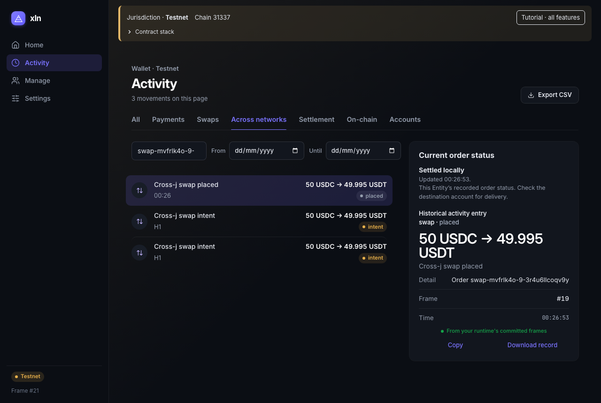
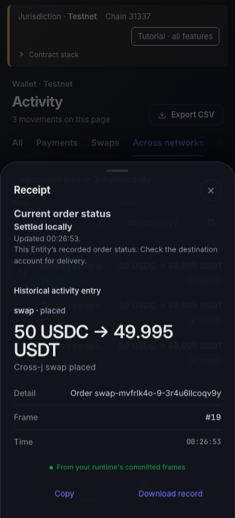

# Current Cross-swap status

Activity previously showed only historical `placed` and `intent` entries for a settled order. The receipt now reads the exact order from committed Entity state under the existing Runtime read lease. It exposes seven scalar fields and no registry secrets. The historical receipt remains unchanged.

L1: 4/4 tests, 14 assertions. L2: 2/2 real Cross-swap cases, both bilateral legs and same-WAL recovery, with desktop and mobile receipt checks. See [proof.json](proof.json) for exact source and log hashes. These are two EVM jurisdictions, not native TVM.

